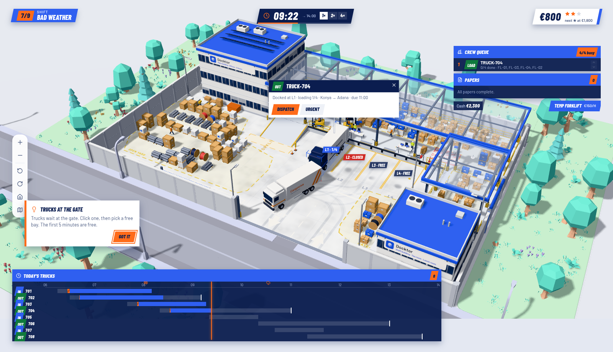
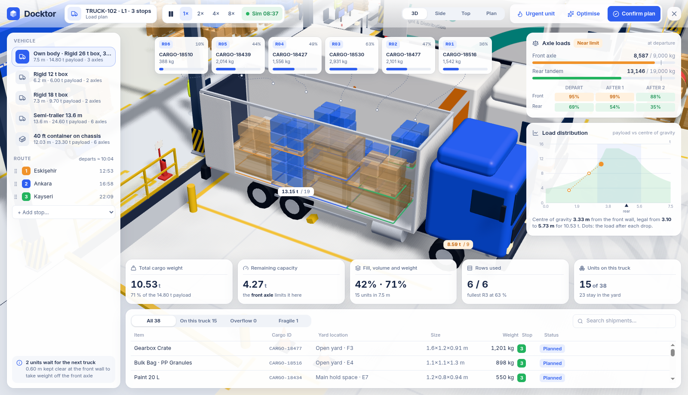

# Docktor · Yard Manager

A training game for yard managers, set in a 3D logistics yard. You run a shift: trucks arrive
at the gate, you decide which bay each one gets, where incoming cargo is stored, how outbound trucks
are loaded and when they leave, and a forklift crew carries out your decisions against the clock.
The shift is scored in money, and every fine names the rule behind it.

**Live demo: https://warehouse-yard-dashboard.vercel.app/**



## How a shift plays

- **The clock.** A shift runs 06:00–14:00 on the scoreboard, about 13 real minutes at 1×. Speed it
  up with 2× / 4× / 8× (keys `1` `2` `3` `4`). `Esc` pauses, and covers the yard while paused.
- **Five bays.** L1–L4 back onto the covered platform; L5 stands along the gate wall next to the open
  yard, its rear on a yard ramp so forklifts can load it from the ground.
- **Lunch** is 12:00–13:00: jobs under way are finished, but no new forklift job or paperwork starts
  until 13:00. Trucks keep arriving.
- **Inbound trucks** queue at the kerb outside the gate. The first 5 minutes are free; after that
  waiting costs €12 a minute. Click a truck, send it to a free bay, pick a storage area, and the
  crew unloads it (€40 per unit stored).
- **Outbound trucks** come to collect. Give one a bay, press **Plan load**: the load planner packs it
  from the yard, checking axle loads, stacking, fragile units and drop order. Confirm, and the crew
  loads it. Dispatch it before its deadline (€80 per unit delivered, €15 a minute if late).
- **The crew** works a job queue from the top. Move jobs up or down, or mark a truck urgent.
- **Trouble:** missing papers (a clerk fixes them, or rush one for €40), forklift breakdowns (rent a
  temp forklift), rain (move cartons and bags under cover), closed bays, rush orders, overtime.
- **The report** at full time shows profit and stars, the money in and out, every fine with its time
  and rule, and one lesson for the retry.

## Creative mode

The **Creative** tab on the left edge (or the `` ` `` key) opens an admin panel for seeing the game
without playing it: skip time (+15 min, +1 h, to 13:00, end the shift), fast-forward at 16× / 32× / 64×,
**Autopilot** (the good test bot makes every decision, also while skipping), **No cash limit**,
**Hide hints**, **All shifts open**, start any shift straight away, and reset the campaign progress.

## The campaign

| # | Shift | Teaches |
|---|---|---|
| 1 | Opening the gate | Bays and the gate waiting fee |
| 2 | Where it goes | Choosing the storage area |
| 3 | First load | Load planner, dispatch, deadlines |
| 4 | Paper chase | Missing papers, the clerk, rush fees |
| 5 | The queue | Reordering jobs, urgent trucks |
| 6 | Breakdown | Renting a temp forklift |
| 7 | Bad weather | Rain, cover, a closed bay |
| 8 | Rush order | A surprise truck, overtime |
| 9 | Peak day | Everything at once |

One star unlocks the next shift. Progress is kept in the browser.

## Load planner



The planner packs the truck from the yard units bound for its stops: the last stop goes to the front
wall, every stop can come out through the doors, nothing is stacked on fragile units, and every axle is
checked at departure and after each drop. **Optimise** tries ~1,000 layouts in a Web Worker and keeps the
best; **Urgent unit** forces a unit on. Units that don't fit wait in the yard with their reason.

## How it's made

- **React + TypeScript + Vite**, 3D with **three.js** via **React Three Fiber** and drei, UI with
  **Tailwind CSS**, state in **Zustand**.
- **The shift engine** (`src/game`) is plain TypeScript: a recipe and a fixed seed generate the shift;
  `act` applies a decision and `advance` fires everything due, in strict time order. The same recipe and
  actions always give the same shift, to the cent. Every truck and forklift move is a one-shot route
  planned at decision time (A* over the yard grid) and played back from the sim clock.
- **Bots and balancing.** Two test bots play every shift headless: a slow-to-react *basic* one and a
  *good* one. Star targets come from what they make (★ = basic, ★★★ = 95 % of good).
- The yard is generated from one config file in meters (`src/config/devYard.ts`), traced from a
  hand-drawn plan. Buildings, vehicles and cargo are procedural low-poly geometry; trees and roads are
  CC0 models by Kenney.

```bash
npm install
npm run dev       # the game
npm test          # engine, planner and UI logic tests
npm run balance   # bot profits and star targets per shift
```

In development, `?shift=<id>&bot=good&t=<seconds>` starts a shift and lets the good bot play it up to a
time (handy for screenshots); `?brief=<id>` opens a briefing.
